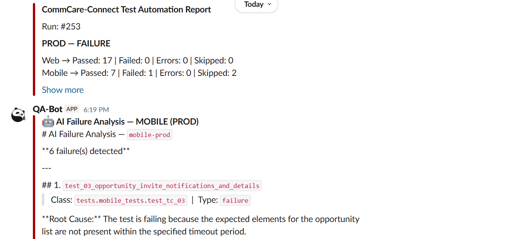

# Dimagi

### CommCare - Connect Pytest Automation Suite

This repository contains an end-to-end **test automation framework** built using **Python, Pytest, Selenium, and Appium**, with full CI/CD integration using **GitHub Actions**.

The framework supports:
- 🌐 Web automation
- 📱 Mobile automation (BrowserStack)
- 📊 Allure reporting
- 🔁 CI/CD pipelines
- 🔔 Slack & Email notifications
- 🌍 Allure report publishing to GitHub Artifacts

---

### 📌 Tech Stack

| Tool           | Purpose              |
|----------------|----------------------|
| Python 3.10    | Programming language |
| Pytest         | Test framework       |
| Selenium       | Web automation       |
| Appium         | Mobile automation    |
| BrowserStack   | Cloud mobile testing |
| Allure         | Test reporting       |
| GitHub Actions | CI/CD                |
| Slack          | Notifications        |

---

### 📂 Project Structure
```
Dimagi/
├── .github/
│ └── workflows/
│
├── .venv/
│
├── app/
│
├── config/
│
├── drivers/
│
├── locators/
│
├── pages/
│ ├── web_pages/
│ └── mobile_pages/
│
├── reports/
│ ├── allure-report/
│ ├── allure-results/
│ └── results.xml
│
├── test_data/
│
├── tests/
│ ├── web_tests/
│ └── mobile_tests/
│
├── utils/
│
├── .gitignore
├── conftest.py
├── pytest.ini
├── README.md
├── settings-sample.cfg
└── requirements.txt

```
---

### 🧠 Framework Design Highlights
- **Page Object Model (POM)** for clean separation of tests and UI logic
- **Pytest fixtures** for driver management and setup/teardown
- **Separate execution flows** for Web and Mobile tests
- **Allure reporting** for detailed test insights
- **Pytest reporting** for easier access and test insights
- **CI/CD ready** with GitHub Actions
- **BrowserStack integration** for cloud mobile execution
- **Secure secrets handling** via GitHub Secrets

---

### 📌 Key Directories Explained

| Directory            | Purpose                                          |
|----------------------|--------------------------------------------------|
| `tests/`             | Contains all web and mobile test cases           |
| `pages/`             | Page Object Model implementations                |
| `locators/`          | Element locators for web and mobile tests        |
| `drivers/`           | WebDriver and Appium driver setup                |
| `config/`            | Environment and capability configurations        |
| `test_data/`         | Test data required for web and mobile test cases |
| `reports/`           | Allure reports and test artifacts                |
| `utils/`             | Reusable helper utilities                        |
| `.github/workflows/` | CI/CD pipeline definitions                       |

---

### 🗂️ Test Data Configuration (Web & Mobile)

All test-related data is maintained under the `test_data/` directory.

- Update or add new test data files as required for your test cases.
- Ensure the data format matches what is expected by the corresponding test cases.
- Test data can be customized separately for:
  - Web tests located under `test_data/web_test_data`
  - Mobile tests located under `test_data/mobile_workers`

Any changes made in test data will directly affect test execution.

---

### 🛠️ Environment Configuration (`config` Folder)

The `config/` directory contains environment-specific configuration files.

#### `env.yaml`
- Used to manage environment-level settings such as:
  - Application URLs
  - BrowserStack URL
  - Appium local server URL
- Modify this file to switch between environments (e.g., Staging, Production).

#### `android_caps.json`
- Used for mobile automation configuration.
- Update this file to modify Android capabilities such as:
  - Device name
  - Platform name & version
  - App package and activity
  - Other Appium-related capabilities

#### `settings-sample.cfg`
- Used to manage test credentials and execution platform:
  - Rename the file settings-sample.cfg to settings.cfg
  - Execution platform for mobile tests- "browserstack" or "local" (in case an emulator is setup on local)
  - BrowserStack Username and Access Key
  - Commcare login credentials
- Modify this file to switch between Execution platforms, user credentials.

---

### 📱 Mobile Application Update

The `app/` directory contains the Android application `.apk` file.

- When a new version of the mobile app is available:
  - Replace the existing APK in the `app/` folder with the new version.
  - Ensure the APK name and path match the values defined in the configuration.

---

### Local vs BrowserStack Execution

By default:
- Web tests run locally
- Mobile tests run on BrowserStack

### ⚙️ Prerequisites

- Python **3.10+**
- Google Chrome (for web tests)
- BrowserStack account (for mobile tests)

### 📦 Install Dependencies

```bash
pip install -r requirements.txt
```

### 🔑 Storing Environment Variables
BrowserStack (Required for Mobile Tests)

```bash
Run the below commands in terminal/PowerShell
```

```bash
macOS / Linux
export BROWSERSTACK_USERNAME=your_username
export BROWSERSTACK_ACCESS_KEY=your_access_key
```

```bash
Windows
$env:BROWSERSTACK_USERNAME="your_username"
$env:BROWSERSTACK_ACCESS_KEY="your_access_key"
```

### ▶️ Run Tests Locally
Run Web Tests
```
pytest -v tests/web_tests
```

Run Mobile Tests
```
pytest -v tests/mobile_tests
```

Run a specific test file
```
pytest -v tests/web_tests/test_olp_1_2_3.py
pytest -v tests/mobile_tests/test_tc_1.py 
```

### 📊 Normal Pytest Reports (Local Execution)
Generate Allure Results
```
pytest -v tests/web_tests --html=report.html --self-contained-html --tb=short
```
No extra steps needed to generate the reports after execution.

### 📊 Allure Reports (Local Execution)
Generate Allure Results
```
pytest -v tests/web_tests --alluredir=reports/web/allure-results
```

Generate HTML Report
```
allure generate reports/web/allure-results -o reports/web-allure-report --clean
```

Open Report
```
allure open reports/web-allure-report
```
⚠️ allure open works only on local machines, not in CI/CD.

---

### 🚀 CI/CD with GitHub Actions
Trigger Conditions
- Push to main
- Pull request to main
- `workflow_dispatch` for manual workflow execution

CI Pipeline Includes
- Web tests execution
- Mobile tests execution (BrowserStack)
- Allure report generation
- Slack & email notifications

Steps to Open Allure report from GitHub Artifacts
- Download the Allure report zip file from workflow artifacts
- Unzip and extract the files in file explorer
- Execute the below command in Windows PowerShell
```bash
allure open "path_to_downloaded_report_folder"
```

Steps to Open Pytest report from GitHub Artifacts
- Download the html report zips file from workflow artifacts
- Unzip and extract the files in file explorer
- Or if your email address is one of the recipients in the email notifications, the report.html files for we and prod will be attached 

### 🔐 GitHub Secrets Configuration
Add secrets under:

Repository → Settings → Secrets and variables → Actions

| Secret Name             | Description                    |
|-------------------------|--------------------------------|
| BROWSERSTACK_USERNAME   | BrowserStack username          |
| BROWSERSTACK_ACCESS_KEY | BrowserStack access key        |
| SLACK_WEBHOOK_URL       | Slack incoming webhook         |
| FROM_EMAIL_USERNAME     | Username of the sender email   |
| FROM_EMAIL_PASSWORD     | Password of the sender email   |
| TO_EMAIL_USERNAME       | Username of the receiver email |

---

### 🔔 Configuring Slack Incoming Webhook for Notifications

To enable the CI pipeline to send notifications to a specific Slack channel, follow these steps:

1. **Open Slack and navigate to workspace settings**  
   - Click on your ***workspace name*** in the top left corner of Slack.  
   - Select ***Tools & Settings → Manage Apps***.  
     This will open the ***Installed Apps*** section of the Slack Marketplace.

2. **Add Incoming Webhooks**  
   - Search for ***Incoming WebHooks*** in the marketplace.  
   - Click ***Add to Slack***.

3. **Select the channel for notifications**  
   - Choose the Slack channel where you want the notifications to appear from the dropdown.  
   - Click ***Add Incoming Webhook Integration***.

4. **Copy the Webhook URL**  
   - After adding the integration, Slack will provide a ***Webhook URL***.  
   - Copy this URL — it will be used to send messages to the selected channel.

5. **Store the Webhook URL securely**  
   - In your ***GitHub repository***, navigate to:
     ```
     Settings → Secrets and variables → Actions
     ```  
   - Click ***New repository secret*** and add:  
     - **Name:** `SLACK_WEBHOOK_URL`  
     - **Value:** `<your-webhook-url>`  

> The webhook URL should be treated as a secret; anyone with this URL can post messages to the channel.

**Currently the channel showcasing the Connect test results is #qa-connect-automated-test-results**

### ✉️ Configuring Email Notifications

The framework can send test execution notifications via email. Follow these steps to securely set up email notifications using GitHub repository secrets:

1. **Store Sender Email Credentials**

   - Save the *sender email username* and *password* as GitHub secrets.  
   - **Important:** For security, use an *app password* instead of your real email password if your email provider supports it (e.g., Gmail, Outlook).

   - `FROM_EMAIL_USERNAME` → your email address
   - `FROM_EMAIL_PASSWORD` → app password  


2. **Store Recipient Email Addresses**

   - Save the *recipient email addresses* as a comma-separated string in a GitHub secret.
   - `TO_EMAIL_USERNAME` → `qa1@example.com, qa2@example.com`  

> The workflow or script will use these secrets to send notifications to the specified recipients.

---
### ▶️ Manually Trigger Tests on Github
- Go to link : https://github.com/dimagi/dimagi-qa-ccc/actions/workflows/dimagi_pytest.yaml
- Find the Run workflow button on the Right side of the screen
- 
- The above screen will open with 3 fields: Branch (select main), Environment (prod or stage or both), Scope (web or mobile or both)
- Once all fields are selected, click on the green Run workflow button

---
### 🎯 Feature Runs (run part of a suite)
Both suites can run just one area instead of everything. Open the workflow, click **Run workflow**, pick the branch and environment, then use **What to run**:

| Suite | Workflow | What to run | Exact list instead |
| --- | --- | --- | --- |
| Web | [playwright_web.yaml](https://github.com/dimagi/dimagi-qa-ccc/actions/workflows/playwright_web.yaml) | Full suite, an app area (Opportunities, Programs, Opportunity dashboard, Workers, Tasks, Messaging, Microplanning, Invoices, PersonalID), or **Connect PR** | `tests`, e.g. `tests/test_olp_04.py tests/test_plp_list_page.py` |
| Mobile | [maestro_mobile.yaml](https://github.com/dimagi/dimagi-qa-ccc/actions/workflows/maestro_mobile.yaml) | Full suite, Login, Map, Profile, Recovery | `flows`, e.g. `profile_view.yaml` |

- **Connect PR** (web only): enter a commcare-connect PR number in `connect_pr`. The run covers only the tests that PR affects, worked out from its diff by `playwright_web/utils/impact_check.py`. Locally: `cd playwright_web && python -m utils.impact_check --pr <n> --tests`.
- **The change must be deployed first.** The suites test a deployed environment (staging or prod), not a branch, so put the feature on staging before a stage run.
- Web areas are picked by test file name (`tests/test_olp_*.py` is Opportunities, etc.), so a new test file joins its area automatically. Mobile areas come from each flow's `tags:` header; a new flow in `TEST_FLOWS` needs one.
- The Slack card, email and run name say what ran (for example `Programs · stage`), so a partial run isn't mistaken for a full one.

## ⚠️ Mobile Test Execution – Important Considerations

### 1. Payment Flow Limitation (TC_6)

- **TC_6 (Payment Flow)** can be executed **only once per user per day as per functionality**.
- If this test needs to be re-run multiple times:
  - Update the user details in:
    ```
    test_data/mobile_workers.yaml
    ```
  - Use a **different user** for each execution.

This limitation is due to business rules on the backend.

**P.S. This testcase is currently skipped due to a known bug on the latest apks.

